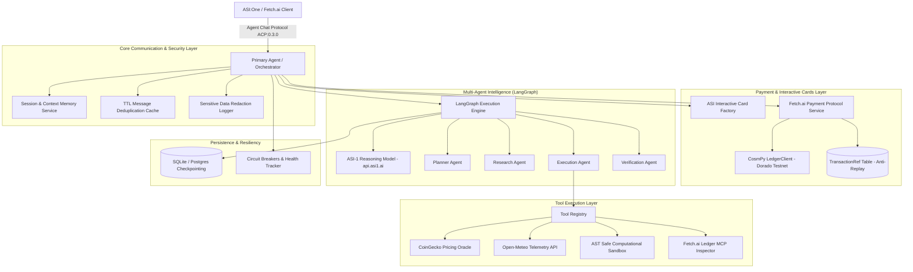

# Stranger Builds 2026 – Autonomous Agent Architecture

This document provides a technical overview of the production multi-tier architecture implementing the Stranger Builds 2026 autonomous multi-agent execution system.

---

## 1. High-Level Architecture Overview

---

## 2. Layer-by-Layer Architectural Breakdown

### 2.1 Communication & Protocol Layer (`protocols/`, `agents/primary_agent.py`)
* **Standard Fetch.ai ACP**: Implements `AgentChatProtocol:0.3.0` (digest `proto:30a801ed3a83f9a0ff0a9f1e6fe958cb91da1fc2218b153df7b6cbf87bd33d62`).
* **Message Models**: Strictly uses official `uagents_core.contrib.protocols.chat` models:
  * `ChatMessage`, `ChatAcknowledgement`
  * `StartSessionContent`, `EndSessionContent`, `TextContent`, `MetadataContent`
* **Protocol Manifest**: Automatically publishes its cryptographic protocol manifest upon startup (`agent.include(chat_proto, publish_manifest=True)`).
* **Agentverse Readiness**: Configured with deterministic seed, Almanac registration metadata, and inspection endpoint `GET /` and `/health`.

### 2.2 ASI Interactive Cards Layer (`cards/`)
* Compliant with official Fetch.ai ASI Interactive Cards documentation.
* Serializes cards into ACP `MetadataContent` containing stringified metadata and payload schemas:
  1. **Input Forms**: Interactive parameter collection forms for autonomous workflows.
  2. **Selection Cards**: Multi-option selection cards for choosing specialized capabilities.
  3. **Detail Cards**: Structured telemetry views with source attribution and refresh triggers.
  4. **Review Screens**: Task scope, fee calculation, and payment authorization prompts.
  5. **Confirmation Cards**: On-chain transaction receipts and verification badges.
  6. **Result Cards**: Multi-agent consensus execution summaries with quality verification stamps.

### 2.3 Fetch.ai Payment Protocol Layer (`payment/`)
* **Pay-per-Task Microtransactions**:
  * Free queries: Status, ping, help (`0.0 FET`).
  * Premium tasks: Multi-agent execution, live oracle synthesis, valuation (`0.05 FET`).
* **Two-Phase Authorization**: Generates an ACP `ReviewCard` presenting the required fee, task ID, and merchant address before triggering paid execution.
* **On-Chain Ledger Verification**: Uses `cosmpy.aerial.client.LedgerClient` connected to the Fetch.ai Dorado Testnet (`fetchhub-4` / `dorado-1`) to query transaction status on-chain.
* **Strict Anti-Replay Protection**: The `TransactionRef` database table enforces unique transaction hashes (`tx_hash`). Double-spending attempts are rejected with `PaymentStatus.DUPLICATE_REJECTED`.
* **Zero Simulation Guarantee**: Payments are never simulated. Unfunded or missing transactions immediately halt task execution.

### 2.4 Multi-Agent Intelligence Layer (`orchestration/`, `agents/`)
* **ASI-1 Primary Reasoning**: Direct integration with `https://api.asi1.ai/v1` via `ASI1Client`, handling intent understanding, dynamic task planning, and result synthesis.
* **Four Specialized Agents**:
  1. `PlannerAgent`: Analyzes intent and constructs execution DAGs with dependency tracking.
  2. `ResearchAgent`: Queries live external APIs and market telemetry.
  3. `ExecutionAgent`: Executes verified tools within an AST-sandboxed computation runner.
  4. `VerificationAgent`: Verifies accuracy, checks threshold bounds, and triggers LangGraph retry routing upon discrepancy.
* **LangGraph Orchestrator**: Manages state transitions, conditional branching (`should_retry`), state checkpointing (`MemorySaver` / DB), and exponential backoff retry.

### 2.5 Resiliency & Reliability Layer (`core/reliability.py`)
* **Circuit Breakers**: State-machine breakers (`CLOSED`, `OPEN`, `HALF_OPEN`) protecting against cascading failures from external API rate-limits or outages.
* **Exponential Backoff**: Jittered async retries for transient HTTP and RPC network anomalies.
* **Central Health Tracker**: Aggregates component health across agent core, database, cache, ASI-1, and ledger clients for `/health` endpoint consumption.
