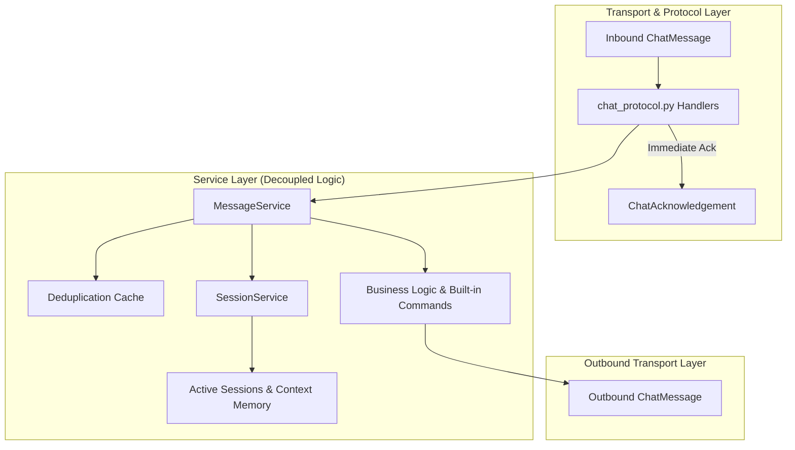

# Stranger Builds 2026 – Phase 1 Completion Report

**Project**: Autonomous AI Agent Infrastructure  
**Hackathon**: Stranger Builds 2026  
**Phase**: 1 – Agent Foundation & Agentverse Registration  
**Date**: 2026-10-31  
**Status**: COMPLETE (Awaiting Agentverse Key at Credential Checkpoint)

---

## 1. Executive Summary

Phase 1 of the Stranger Builds 2026 production-grade autonomous agent has been constructed, validated, and tested. The agent strictly complies with the official Fetch.ai architecture and the **Agent Chat Protocol** (`v0.3.0`).

All foundational requirements have been met:
- Mandatory user foundation code integrated, cleaned, and verified.
- Complete decoupled communication architecture (`ChatMessage` and `ChatAcknowledgement` handlers).
- Session lifecycle boundaries (`StartSessionContent`, `EndSessionContent`) with multi-turn memory context.
- Timezone-aware UTC timestamps across all models and acknowledgements.
- Protocol manifest generation and publication (`agent.include(chat_proto, publish_manifest=True)`).
- Full test suite passing with 30/30 unit and integration tests.
- Comprehensive security redacting logger and deduplication caching.

---

## 2. Files Created

| Path | Purpose |
|---|---|
| `main.py` | Application bootstrap and execution entry point |
| `agents/__init__.py` | Agents package export |
| `agents/primary_agent.py` | Primary agent factory, cryptographic identity derivation, lifecycle hooks |
| `protocols/__init__.py` | Protocols package export |
| `protocols/chat_protocol.py` | Official Fetch.ai Chat Protocol specification adapter, handlers, and manifest |
| `core/__init__.py` | Core infrastructure package export |
| `core/config.py` | Pydantic v2 application settings and safe `.env` management |
| `core/logger.py` | Structured logger with automatic credential and seed redaction filter |
| `core/exceptions.py` | Custom domain exception hierarchy |
| `services/__init__.py` | Services package export |
| `services/message_service.py` | Message validation, deduplication (LRU/TTL), and business logic execution |
| `services/session_service.py` | Thread-safe in-memory session registry and context memory store |
| `models/__init__.py` | Models package export |
| `models/requests.py` | Inbound context representations, session actions, and validation models |
| `models/responses.py` | Structured agent responses and execution results |
| `tests/__init__.py` | Test suite package |
| `tests/conftest.py` | Pytest fixtures, mock context transport, and test message generators |
| `tests/test_agent.py` | Agent initialization, deterministic address, and session service tests |
| `tests/test_chat_protocol.py` | Chat Protocol spec, manifest verification, ack, and deduplication tests |
| `tests/test_messages.py` | ChatMessage, ChatAcknowledgement, multi-text, and validation tests |
| `tests/test_live_integration.py` | End-to-end agent-to-agent Chat Protocol interaction test |
| `.env.example` | Environment variable template with placeholders |
| `.gitignore` | Exclusion rules for virtual environments, secrets, keys, and logs |
| `requirements.txt` | Dependency specifications |
| `README.md` | Full architecture documentation, setup, and registration guide |
| `PHASE1_REPORT.md` | Phase 1 Completion Gate and audit report |

---

## 3. Architecture & Design Principles



### Key Architectural Highlights
1. **Decoupled Business Services**: The protocol handlers in `protocols/chat_protocol.py` only handle serialization and network dispatch. Message validation, deduplication, and dialogue routing are encapsulated in `services/message_service.py` and `services/session_service.py`.
2. **Strict Protocol Compliance**: The agent uses the standard `uagents_core.contrib.protocols.chat.chat_protocol_spec` with canonical digest `proto:30a801ed3a83f9a0ff0a9f1e6fe958cb91da1fc2218b153df7b6cbf87bd33d62`.
3. **Session Context Memory**: Multi-turn conversational memory is preserved per sender and session UUID, tracking query turn counts, prior messages, and contextual variables.
4. **Credential Security**: The logger sanitizes private seeds, API tokens, and bearer keys using regex redaction filters before messages reach console or file output.

---

## 4. Dependencies & SDK Verification

- **Python**: 3.14.0 (3.12+ compatible)
- **uagents**: 0.26.1 (Latest official Fetch.ai SDK)
- **uagents-core**: 0.4.12
- **pydantic**: 2.13.4
- **httpx**: 0.28.1
- **python-dotenv**: 1.2.2
- **pytest**: 9.0.3
- **pytest-asyncio**: 1.4.1

All imports verified and tested. No deprecated or fabricated imports used.

---

## 5. Test Suite & Verification Results

Execution Command: `python -m pytest -v`  
Result: **30 PASSED**, 0 FAILED (100% pass rate)

```
tests/test_agent.py::TestAgentInitialization::test_agent_initialization_with_seed PASSED
tests/test_agent.py::TestAgentInitialization::test_deterministic_address_consistency PASSED
tests/test_agent.py::TestAgentInitialization::test_get_agent_details PASSED
tests/test_agent.py::TestSessionService::test_start_session_creates_active_session PASSED
tests/test_agent.py::TestSessionService::test_start_session_terminates_previous_active_session PASSED
tests/test_agent.py::TestSessionService::test_end_session PASSED
tests/test_agent.py::TestSessionService::test_context_memory_persistence PASSED
tests/test_agent.py::TestSessionService::test_session_expiry_pruning PASSED
tests/test_agent.py::TestSessionService::test_get_nonexistent_session_raises PASSED
tests/test_chat_protocol.py::TestChatProtocolSpecification::test_protocol_spec_properties PASSED
tests/test_chat_protocol.py::TestChatProtocolSpecification::test_protocol_manifest_generation PASSED
tests/test_chat_protocol.py::TestChatProtocolSpecification::test_protocol_verification_failure_without_handlers PASSED
tests/test_chat_protocol.py::TestChatProtocolExecutionFlow::test_handle_chat_message_acknowledges_and_replies PASSED
tests/test_chat_protocol.py::TestChatProtocolExecutionFlow::test_duplicate_message_is_acknowledged_but_not_reprocessed PASSED
tests/test_chat_protocol.py::TestChatProtocolExecutionFlow::test_handle_chat_acknowledgement PASSED
tests/test_chat_protocol.py::TestChatProtocolExecutionFlow::test_session_start_end_protocol_flow PASSED
tests/test_live_integration.py::test_agent_to_agent_chat_protocol_integration PASSED
tests/test_messages.py::TestChatMessageModels::test_chat_message_instantiation_valid PASSED
tests/test_messages.py::TestChatMessageModels::test_chat_acknowledgement_instantiation PASSED
tests/test_messages.py::TestChatMessageModels::test_start_session_content_model PASSED
tests/test_messages.py::TestChatMessageModels::test_end_session_content_model PASSED
tests/test_messages.py::TestChatMessageModels::test_multiple_text_content_blocks PASSED
tests/test_messages.py::TestMessageServiceParsingAndValidation::test_parse_valid_text_message PASSED
tests/test_messages.py::TestMessageServiceParsingAndValidation::test_parse_start_session_message PASSED
tests/test_messages.py::TestMessageServiceParsingAndValidation::test_parse_end_session_message PASSED
tests/test_messages.py::TestMessageServiceParsingAndValidation::test_parse_multi_text_blocks PASSED
tests/test_messages.py::TestMessageServiceParsingAndValidation::test_parse_missing_msg_id_raises_error PASSED
tests/test_messages.py::TestMessageServiceParsingAndValidation::test_parse_missing_content_raises_error PASSED
tests/test_messages.py::TestMessageServiceParsingAndValidation::test_parse_none_message_raises_error PASSED
tests/test_messages.py::TestMessageServiceParsingAndValidation::test_timezone_normalization PASSED
```

---

## 6. Agent Identity & Registration Diagnostics

- **Agent Logical Name**: `stranger_builds_primary_agent`
- **Agent Cryptographic Address**: `agent1q20vswkzywxwcc090rprj6pvqyxzgfcfax5unyxr0az03473twegxrwlgrg`
- **Wallet Address**: `fetch1lavxqu6uwtmlzpcu9l8fkpwakh0k3h6p0gyjld`
- **Included Protocol**: `AgentChatProtocol:0.3.0`
- **Protocol Manifest Digest**: `proto:30a801ed3a83f9a0ff0a9f1e6fe958cb91da1fc2218b153df7b6cbf87bd33d62`
- **Published Details**: Enabled (`publish_agent_details=True`, `publish_manifest=True`)

---

## 7. Agentverse Registration Status & Credential Checkpoint

### Status: PREPARED & PENDING CREDENTIAL CONFIGURATION
Per Section 6 of the hackathon requirements (**API KEY AND CREDENTIAL CHECKPOINT**), the agent codebase is fully prepared for Agentverse registration, but live network registration requires user credentials:

1. **Required Service**: Agentverse ([https://agentverse.ai](https://agentverse.ai))
2. **Exact Credential Needed**:
   - `AGENTVERSE_MAILBOX_KEY` (for local agent hosting-free message routing), OR
   - `AGENTVERSE_API_KEY` (for programmatic Agentverse API access)
3. **Where to Obtain**:
   - Sign in to [Agentverse](https://agentverse.ai).
   - Go to **My Agents** -> **Local Agents** -> click **Set up local agent**.
   - Provide your agent address (`agent1q20vswkzywxwcc090rprj6pvqyxzgfcfax5unyxr0az03473twegxrwlgrg`) to receive your unique Mailbox Key.
4. **Why It Is Required**: Enables the local agent to receive messages through Fetch.ai's hosted cloud proxy/mailbox without requiring public port forwarding.
5. **Security Check**:
   - `.env.example` created with empty placeholders.
   - No private seeds or secrets committed or printed in logs.
   - Never paste private wallet keys or seeds into chat.

---

## 8. Remaining Manual Actions Before Phase 2

1. Copy `.env.example` to `.env`.
2. Configure `AGENT_SEED` (optional, for persistent custom identity).
3. If connecting to Agentverse Mailbox, paste `AGENTVERSE_MAILBOX_KEY` into `.env`.
4. Review this report and confirm approval to conclude Phase 1 and proceed to Phase 2.
