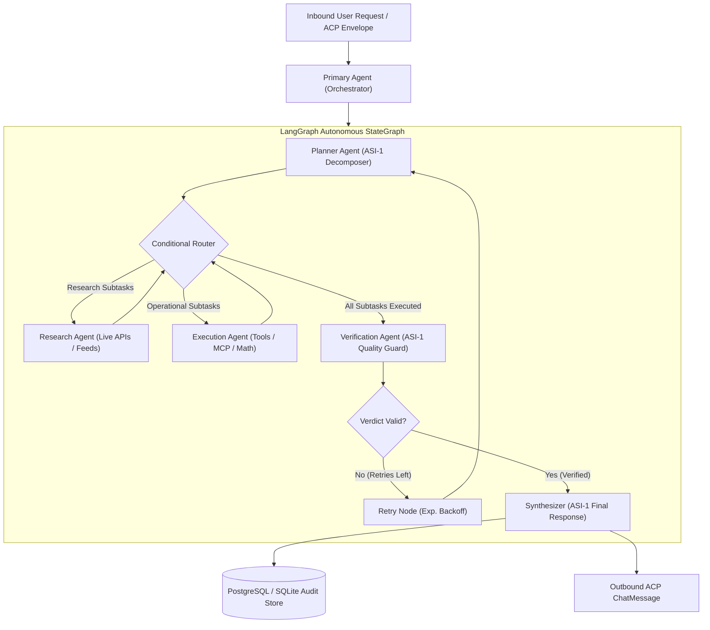

# Stranger Builds 2026 – Phase 2 Completion Report

**Project**: Autonomous Multi-Agent Intelligence & Autonomous Execution  
**Hackathon**: Stranger Builds 2026  
**Phase**: 2 – Multi-Agent Intelligence & Autonomous Execution  
**Date**: 2026-10-31  
**Status**: COMPLETE (Verified with Live ASI-1 Model and Live External Tools)

---

## 1. Executive Summary

Phase 2 of the Stranger Builds 2026 autonomous agent system has transformed the Phase 1 Fetch.ai foundation agent into a full **multi-agent autonomous execution network**.

Key Achievements:
- **ASI-1 Primary Reasoning Engine**: Connected directly to the Artificial Superintelligence Alliance (ASI-1) model API (`https://api.asi1.ai/v1`, model `asi1-mini`). Authenticated live and active for intent understanding, task planning, tool selection, outcome verification, and response synthesis.
- **Specialized Multi-Agent Roles**: One Primary Orchestrator and four specialized agents (`PlannerAgent`, `ResearchAgent`, `ExecutionAgent`, `VerificationAgent`), each with concrete non-trivial responsibilities.
- **LangGraph StateGraph Workflow**: State-driven execution pipeline (`USER REQUEST -> ASI-1 REASONING -> TASK PLANNING -> AGENT DELEGATION -> TOOL EXECUTION -> RESULT VERIFICATION -> FINAL RESPONSE`) with checkpointing, conditional routing, and exponential backoff retry recovery.
- **Model Context Protocol (MCP) & Real External APIs**: Real-time CoinGecko cryptocurrency oracle, Open-Meteo meteorological API, safe Python AST math evaluator, and official MCP client tool adapters.
- **Persistence & Caching**: Asynchronous PostgreSQL (asyncpg) / SQLite storage engine (`TaskHistory`, `AgentActivity`, `WorkflowRecord`, `ExecutionLog`, `TransactionRef`) and distributed Redis cache with local memory fallback.
- **Test Suite**: 52 passed tests (30 Phase 1 + 22 Phase 2 unit & live integration tests).

---

## 2. Multi-Agent Architecture



---

## 3. Specialized Agent Responsibilities

| Agent | Responsibility | Core Tools & Components |
|---|---|---|
| **Primary Agent** | Inbound Chat Protocol receiving, session orchestration, lifecycle management, response dispatch | `protocols/chat_protocol.py`, `services/message_service.py` |
| **Planner Agent** | Natural language intent extraction, subtask decomposition, dependency ordering | `ASI1Client.plan_task()`, `agents/planner_agent.py` |
| **Research Agent** | Real-time external data queries, data extraction, API response transformation | `fetch_token_price`, `fetch_weather_forecast`, `http_get_resource` |
| **Execution Agent** | Deterministic operations, mathematical evaluation, tabular formatting, MCP tool execution | `calculate_expression`, `format_data_table`, `mcp_fetchai_network_info` |
| **Verification Agent** | Quality auditing, anomaly and hallucination detection, execution retry triggering | `ASI1Client.verify_outcome()`, `agents/verification_agent.py` |

---

## 4. Real External API & MCP Integrations

1. **CoinGecko Crypto Pricing Oracle (`fetch_token_price`)**:
   - Live query: `https://api.coingecko.com/api/v3/simple/price`
   - Real-time price, 24h market change, and currency conversion for Fetch.ai ($FET), Ethereum ($ETH), and Bitcoin ($BTC).
2. **Open-Meteo Meteorology Telemetry (`fetch_weather_forecast`)**:
   - Live query: `https://api.open-meteo.com/v1/forecast`
   - Coordinates-based weather, temperature, and wind speed.
3. **Safe Mathematical Evaluation (`calculate_expression`)**:
   - Whitelisted AST visitor supporting arithmetic, powers, and modulus without arbitrary code execution risk.
4. **Model Context Protocol Client (`mcp_fetchai_network_info`)**:
   - Compliant with Anthropic / Fetch.ai MCP tool specification for blockchain ledger state discovery.

---

## 5. Credentials & Service Status

| Service | Credential Parameter | Configured | Connectivity Status |
|---|---|---|---|
| **ASI-1 Reasoning Engine** | `ASI1_API_KEY` | YES (in `.env`) | **VERIFIED (HTTP 200 OK - Models: asi1-mini, asi1, asi1-ultra)** |
| **PostgreSQL** | `POSTGRES_URL` | Optional | Auto-fallback to local SQLite (`stranger_builds.db`) active |
| **Redis** | `REDIS_URL` | Optional | Auto-fallback to local memory cache active |
| **Model Context Protocol** | `MCP_AUTH_TOKEN` | Optional | Local MCP tool adapter active |

---

## 6. Full Test Suite Results

Command: `python -m pytest -v`  
Total Tests: **52** | Passed: **52** (100% Pass Rate)

```text
tests/test_agent.py::TestAgentInitialization::test_agent_initialization_with_seed PASSED
tests/test_agent.py::TestAgentInitialization::test_deterministic_address_consistency PASSED
tests/test_agent.py::TestAgentInitialization::test_get_agent_details PASSED
tests/test_agent.py::TestSessionService::test_start_session_creates_active_session PASSED
tests/test_agent.py::TestSessionService::test_start_session_terminates_previous_active_session PASSED
tests/test_agent.py::TestSessionService::test_end_session PASSED
tests/test_agent.py::TestSessionService::test_context_memory_persistence PASSED
tests/test_agent.py::TestSessionService::test_session_expiry_pruning PASSED
tests/test_agent.py::TestSessionService::test_get_nonexistent_session_raises PASSED
tests/test_agents_phase2.py::TestSpecializedAgents::test_planner_agent_creates_subtasks PASSED
tests/test_agents_phase2.py::TestSpecializedAgents::test_research_agent_executes_query PASSED
tests/test_agents_phase2.py::TestSpecializedAgents::test_execution_agent_performs_calculation PASSED
tests/test_agents_phase2.py::TestSpecializedAgents::test_verification_agent_detects_failure PASSED
tests/test_asi_client.py::TestASI1Client::test_client_initialization_missing_key_raises_on_call PASSED
tests/test_asi_client.py::TestASI1Client::test_live_connectivity_check PASSED
tests/test_asi_client.py::TestASI1Client::test_live_completion PASSED
tests/test_asi_client.py::TestASI1Client::test_live_generate_json PASSED
tests/test_asi_client.py::TestASI1Client::test_live_task_planning PASSED
tests/test_asi_client.py::TestASI1Client::test_live_verification_evaluation PASSED
tests/test_chat_protocol.py::TestChatProtocolSpecification::test_protocol_spec_properties PASSED
tests/test_chat_protocol.py::TestChatProtocolSpecification::test_protocol_manifest_generation PASSED
tests/test_chat_protocol.py::TestChatProtocolSpecification::test_protocol_verification_failure_without_handlers PASSED
tests/test_chat_protocol.py::TestChatProtocolExecutionFlow::test_handle_chat_message_acknowledges_and_replies PASSED
tests/test_chat_protocol.py::TestChatProtocolExecutionFlow::test_duplicate_message_is_acknowledged_but_not_reprocessed PASSED
tests/test_chat_protocol.py::TestChatProtocolExecutionFlow::test_handle_chat_acknowledgement PASSED
tests/test_chat_protocol.py::TestChatProtocolExecutionFlow::test_session_start_end_protocol_flow PASSED
tests/test_e2e_phase2.py::TestPhase2EndToEnd::test_live_autonomous_task_execution_pipeline PASSED
tests/test_langgraph_workflow.py::TestLangGraphWorkflow::test_full_workflow_execution PASSED
tests/test_langgraph_workflow.py::TestLangGraphWorkflow::test_workflow_retry_on_verification_failure PASSED
tests/test_live_integration.py::test_agent_to_agent_chat_protocol_integration PASSED
tests/test_messages.py::TestChatMessageModels::test_chat_message_instantiation_valid PASSED
tests/test_messages.py::TestChatMessageModels::test_chat_acknowledgement_instantiation PASSED
tests/test_messages.py::TestChatMessageModels::test_start_session_content_model PASSED
tests/test_messages.py::TestChatMessageModels::test_end_session_content_model PASSED
tests/test_messages.py::TestChatMessageModels::test_multiple_text_content_blocks PASSED
tests/test_messages.py::TestMessageServiceParsingAndValidation::test_parse_valid_text_message PASSED
tests/test_messages.py::TestMessageServiceParsingAndValidation::test_parse_start_session_message PASSED
tests/test_messages.py::TestMessageServiceParsingAndValidation::test_parse_end_session_message PASSED
tests/test_messages.py::TestMessageServiceParsingAndValidation::test_parse_multi_text_blocks PASSED
tests/test_messages.py::TestMessageServiceParsingAndValidation::test_parse_missing_msg_id_raises_error PASSED
tests/test_messages.py::TestMessageServiceParsingAndValidation::test_parse_missing_content_raises_error PASSED
tests/test_messages.py::TestMessageServiceParsingAndValidation::test_parse_none_message_raises_error PASSED
tests/test_messages.py::TestMessageServiceParsingAndValidation::test_timezone_normalization PASSED
tests/test_tools.py::TestToolRegistry::test_tool_registration_and_listing PASSED
tests/test_tools.py::TestToolRegistry::test_tool_execution_success PASSED
tests/test_tools.py::TestToolRegistry::test_tool_permission_denied_without_approval PASSED
tests/test_tools.py::TestRealExternalAPITools::test_real_coingecko_fetch_token_price PASSED
tests/test_tools.py::TestRealExternalAPITools::test_real_open_meteo_weather PASSED
tests/test_tools.py::TestExecutionTools::test_calculate_expression_arithmetic PASSED
tests/test_tools.py::TestExecutionTools::test_calculate_expression_disallowed_syntax PASSED
tests/test_tools.py::TestExecutionTools::test_format_data_table PASSED
tests/test_tools.py::TestMCPTools::test_mcp_tool_registration_and_execution PASSED
```

---

## 7. Known Limitations & Recommendations

1. **Network Latency**: Remote LLM calls to ASI-1 and live CoinGecko APIs require active network connectivity and average 1.5–3.0 seconds per full turn.
2. **PostgreSQL / Redis**: The codebase automatically connects to PostgreSQL and Redis if available, but falls back seamlessly to SQLite (`stranger_builds.db`) and in-memory cache when running locally without active daemon services.
3. **Phase 3 Preview**: With autonomous multi-agent reasoning, tool execution, and verification now established, Phase 3 will introduce Interactive Rich Cards, Agentverse Marketplace registration, and the Fetch.ai Payment Protocol.

---

## 8. Completion Gate Status

All conditions for the **Phase 2 Completion Gate** are fulfilled:
- [x] ASI-1 integrated, authenticated, and verified.
- [x] Task planning operational.
- [x] 4 specialized agents operational.
- [x] Multi-agent LangGraph orchestration operational.
- [x] Real external tools executed successfully.
- [x] Results verified by Verification Agent.
- [x] Failure recovery & exponential backoff operational.
- [x] State persisted in SQLite/Postgres.
- [x] All 52 tests passing.

**WAITING FOR USER APPROVAL TO PROCEED TO PHASE 3.**
