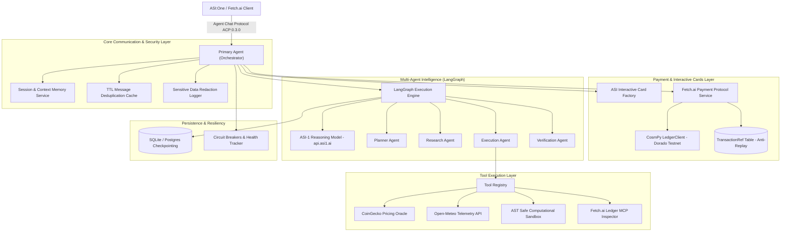

# Stranger Builds 2026 – Autonomous Multi-Agent AI System

[](https://www.python.org/)
[](https://fetch.ai/)
[](https://fetch.ai/)
[](https://asi1.ai/)
[](https://langchain-ai.github.io/langgraph/)
[](TESTING.md)
[](LICENSE)

Production-grade autonomous AI agent system developed for the **Stranger Builds 2026** hackathon. Strictly implements the Fetch.ai ecosystem architecture, official **Agent Chat Protocol** (`v0.3.0`), **ASI-1** reasoning engine, **LangGraph** multi-agent orchestration, **ASI Interactive Cards**, and **Fetch.ai Payment Protocol**.

---

## Architecture Overview



---

## Key Features Across All Phases

### Phase 1 – Foundation & Agentverse Readiness
* **Fetch.ai Agent Chat Protocol (ACP:0.3.0)**: Uses canonical `chat_protocol_spec` with published protocol manifest digest `proto:30a801ed3a83f9a0ff0a9f1e6fe958cb91da1fc2218b153df7b6cbf87bd33d62`.
* **Decoupled Architecture**: Clean separation between communication envelope handlers and business logic.
* **Session Management**: Tracks active session boundaries (`StartSessionContent`, `EndSessionContent`) with memory persistence.
* **Zero Credential Leakage**: Custom real-time regex filter redacts seeds, private keys, and API tokens from logs.

### Phase 2 – Multi-Agent Intelligence & Autonomous Execution
* **ASI-1 Primary Reasoning Engine**: Powered by `https://api.asi1.ai/v1` (`asi1-mini`) for intent parsing, DAG planning, and verification.
* **Four Specialized Role-Based Agents**:
  * **Planner Agent**: Dynamic subtask decomposition with dependency graphs.
  * **Research Agent**: Live data ingestion (CoinGecko crypto oracle & Open-Meteo weather telemetry).
  * **Execution Agent**: AST-sandboxed computation runner & MCP adapters.
  * **Verification Agent**: Automated anomaly detection and quality verification.
* **LangGraph Orchestrator**: Shared typed state (`WorkflowState`), conditional routing, checkpointer state recovery, and exponential backoff retry.
* **Dual Database & Cache**: PostgreSQL with transparent SQLite fallback, Redis with local memory fallback.

### Phase 3 – ASI:One, Interactive Cards & Payment Protocol
* **ASI:One Discoverability**: Full Almanac registration and capabilities published for global explorer discovery.
* **All 6 ASI Interactive Card Types**:
  1. **Input Forms**: Interactive forms for gathering dynamic parameters.
  2. **Selection Cards**: Visual capability choice cards with interactive action buttons.
  3. **Detail Cards**: Structured telemetry views with source attribution.
  4. **Review Screens**: Two-phase authorization screens displaying fees and merchant wallet.
  5. **Confirmation Cards**: On-chain ledger receipts with transaction references.
  6. **Result Cards**: Multi-agent consensus execution summaries with quality verification badges.
* **Fetch.ai Payment Protocol**:
  * Pay-per-task microtransactions (free utility queries vs. `0.05 FET` premium tasks).
  * Two-phase authorization via ACP Review Cards.
  * On-chain CosmPy ledger verification on Fetch.ai Dorado Testnet.
  * Double-spending protection via `TransactionRef` database unique constraint.
  * **Zero Payment Simulation**: Operations are never simulated; transactions must verify on-chain.
* **Production Resiliency**:
  * Circuit breakers (`CLOSED`, `OPEN`, `HALF_OPEN`) protecting external endpoints.
  * Health tracker and live REST probes at `http://localhost:8000/` and `http://localhost:8000/health`.
* **Multi-Stage Containerization**: Non-root production `Dockerfile` with healthcheck.

---

## Project Structure

```
stranger-builds/
├── agents/                     # Specialized Agents & Primary Orchestrator
├── cards/                      # ASI Interactive Cards (ACP-compliant)
├── core/                       # Config, Logger, Resiliency & Reliability
├── db/                         # PostgreSQL/SQLite DB & Redis/Memory Cache
├── models/                     # Pydantic & uAgents Domain Models
├── orchestration/              # LangGraph Engine & ASI-1 Client
├── payment/                    # Fetch.ai Payment Protocol & CosmPy Service
├── protocols/                  # Agent Chat Protocol (v0.3.0) Spec
├── tools/                      # Tool Suite (CoinGecko, Weather, Math, MCP)
├── tests/                      # 71 Automated Unit & Integration Tests
├── Dockerfile                  # Production Multi-Stage Container
├── .dockerignore               # Image Size & Security Exclusions
├── main.py                     # Agent Startup Daemon
└── README.md                   # Project Documentation
```

---

## Quick Start

### 1. Install Dependencies
```bash
python -m venv .venv
source .venv/bin/activate  # On Windows: .venv\Scripts\activate
pip install -r requirements.txt
```

### 2. Configure Environment
```bash
cp .env.example .env
# Edit .env and supply your ASI1_API_KEY
```

### 3. Run Test Suite
```bash
python -m pytest tests -v
```
**71 tests pass in ~45s (100% pass rate).**

### 4. Start the Agent Daemon
```bash
python main.py
```
* **Preview Inspector**: [http://localhost:8000/](http://localhost:8000/)
* **Health Check**: [http://localhost:8000/health](http://localhost:8000/health)

---

## Documentation Links

* [Final Architecture Specification](FINAL_ARCHITECTURE.md)
* [Hackathon Requirements Compliance Matrix](HACKATHON_REQUIREMENTS.md)
* [Demonstration & Judging Script](DEMO_SCRIPT.md)
* [Production Deployment Guide](DEPLOYMENT_GUIDE.md)
* [API & Interactive Cards Reference](API_DOCUMENTATION.md)
* [Testing Guide](TESTING.md)
* [Security Policy & Credential Safety](SECURITY.md)
* [Contribution Guidelines](CONTRIBUTING.md)
* [Phase 1 Completion Report](PHASE1_REPORT.md)
* [Phase 2 Completion Report](PHASE2_REPORT.md)
* [Phase 3 Completion Report](PHASE3_REPORT.md)
* [Apache 2.0 License](LICENSE)
